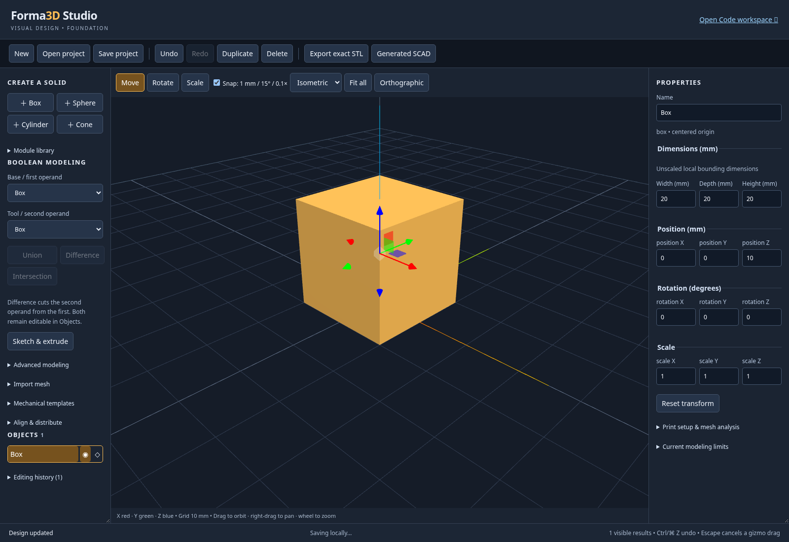
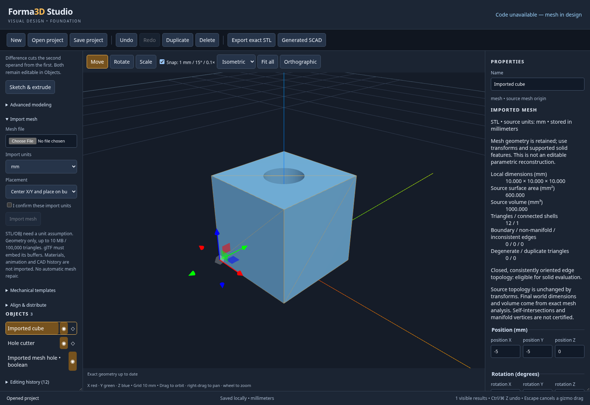

# Run Forma3D Studio: from clone to a working installation

Forma3D Studio is the visual CAD workspace inside this repository's OpenSCAD
Playground application. The repository/package names remain
`openscad-playground`; the visual workspace is selected with `?studio=1`.
There is no separate Forma3D executable to install.

This guide covers a local development installation, a production build, optional
MCP integration, verification, updates, backups and common setup failures.
See [USER_GUIDE.md](USER_GUIDE.md) for modeling instructions,
[FEATURES.md](FEATURES.md) for supported operations and limits, and
[TESTING.md](TESTING.md) for the recorded verification results.

## 1. Prerequisites

| Requirement | Purpose |
| --- | --- |
| Git | Clone this repository and its pinned OpenSCAD libraries. |
| Node.js 24 LTS, with npm | Recommended runtime; repository minimum is Node 22. |
| `curl` or `wget`, `zip`, `unzip` | Download and package the engine, fonts and libraries. |
| Modern browser with WebAssembly and WebGL | Run the geometry engine and interactive viewport. Chromium is the verified engine. |
| Internet access during installation | npm packages, the prebuilt OpenSCAD engine, fonts and pinned library repositories. |

Linux, macOS and Windows through WSL2 provide the Unix shell and symlink support
used by the setup scripts. The verification record is for Linux/Chromium; macOS
and WSL2 instructions are provided without claiming separate platform testing.
Run Windows commands inside the WSL2 Linux shell, not Command Prompt/PowerShell.
Keep the checkout in the Linux filesystem, for example `~/projects`.

On Debian/Ubuntu/WSL2, install the command-line tools:

```sh
sudo apt-get update
sudo apt-get install -y git curl wget zip unzip
```

Install Node 24 LTS using [Node.js](https://nodejs.org/en/download) or a version
manager. If you already use [nvm](https://github.com/nvm-sh/nvm), run:

```sh
nvm install 24
nvm use 24
```

On macOS, install Git/Node and the archive utilities through your normal package
manager or the official Node installer. Verify your tools before continuing:

```sh
git --version
node --version
npm --version
zip -v
unzip -v
```

Docker and a C++ compiler are **not required** for the normal prebuilt-engine
installation. Building the engine or optional JavaScript fallback from source is
a separate advanced workflow documented in [docs/WASM_FALLBACK.md](docs/WASM_FALLBACK.md).

## 2. Clone and install dependencies

Choose a development directory, then run:

```sh
git clone https://github.com/SequentialExecutor/openscad-playground.git
cd openscad-playground
PUPPETEER_SKIP_DOWNLOAD=true npm ci
(cd server && npm ci)
```

`npm ci` uses the committed lockfiles. Run the root install **before** the asset
build: the build uses webpack and repository plugins from `node_modules`.
The `server` install provides the optional MCP service and the TypeScript runner
used by unit checks; the browser CAD application itself does not need the MCP
server running.

`PUPPETEER_SKIP_DOWNLOAD=true` skips Puppeteer's browser download during setup.
It does not disable application functionality. Install system Chromium later if
you want to run the automated browser checks. Alternatively, omit the variable
and let Puppeteer install its supported browser.

## 3. Download the geometry engine, fonts and libraries

From the repository root:

```sh
npm run build:libs
```

This step downloads the configured prebuilt OpenSCAD JavaScript/WASM pair,
prepares the bundled fonts, checks out 25 pinned library repositories and creates
their ZIP archives plus `public/libraries/index.json`. It also creates the
`src/wasm` and `public/openscad.*` links used by the application build.
Allow several minutes for a first run. Downloads/checkouts are cached under
`libs/`; subsequent runs reuse them where possible.

In the managed cloud environment, Node 24 needs its configured proxy enabled for
these downloads:

```sh
NODE_USE_ENV_PROXY=1 npm run build:libs
```

Keep the environment's proxy and CA configuration. Do not disable TLS verification.
For a normal machine without a proxy, the first command is sufficient. Required
hosts include npm's registry, GitHub/raw GitHub and `files.openscad.org`.

Do not skip this step on a fresh checkout. `npm ci` alone does not create the
WASM module, font archive or library index. `npm run build:libs:wasm` refreshes
only the engine; `npm run build:libs:fonts` refreshes only fonts. They are useful
for repairs, but do not replace the complete initial asset build.

## 4. Run the development application

```sh
npm start
```

Keep the terminal running, then open:

- **Forma3D Studio:** <http://localhost:4000/?studio=1>
- **Original OpenSCAD Code workspace:** <http://localhost:4000/>

The Code workspace may load Monaco from its existing CDN, so its initial editor
load can still depend on network access/caching; complete offline operation is
not guaranteed. Geometry evaluation runs locally in the browser worker.

The Code workspace also includes a **Forma3D Studio · Visual Design** link.
Both workspace links synchronize the current design before switching. Native
primitive edits remain editable visual shapes, expressed directly as OpenSCAD
primitives and operations without automatic object wrappers. Authored code modules
are supported through the [reusable module library](USER_GUIDE.md#reusable-code-modules). Any mesh body disables
the Visual Design → Code link, even when hidden or consumed by a feature.
Unsupported code remains in Code rather than being converted into an opaque mesh.
The Generated SCAD panel remains read-only; use **Open Code workspace** for editing. See the
[round-trip workflow and limits](USER_GUIDE.md#switch-between-visual-modeling-and-code).
Shared workspace URLs are local to this browser; use native downloads to move
projects between browsers.

Stop the development server with Ctrl+C. To choose another development port:

```sh
npm run start:development -- --port 4100
```

Then use `http://localhost:4100/?studio=1`. Browser recovery is tied to the origin,
so a different port has its own local recovery slot.

## 5. Verify the installation manually

1. Create a **box**. Set width 40, depth 30 and height 20 mm.
2. Move/rotate it, then Undo/Redo. Check the inspector and geometry agree.
3. Choose **Export exact STL**. The first worker invocation can take longer while
   WebAssembly compiles. A successful export downloads `design.stl`.
4. **Save project** downloads a `.forma3d` ZIP. Reload the page and confirm that
   local recovery restores the model. Open your downloaded project separately.
5. Open `examples/forma3d/parametric-enclosure.forma3d` through **Open project**.
   Change its width; the four posts/holes should follow their mounting inset.
6. Expand **Import mesh**, choose `examples/forma3d/source-cube.stl`, select mm,
   confirm the units and import it. Its source dimensions are 10 × 10 × 10 mm.
   The default placement centers X/Y and puts the bottom at Z=0.
7. Open `examples/forma3d/imported-mesh.forma3d` to inspect an imported cube with
   an editable 4 mm through-hole. Its source mesh remains stored in the project.
8. In **Print setup & mesh analysis**, analyze the exact model and review its
   dimensions, topology and labeled heuristic warnings.
9. Return to the Code workspace and render `cube([10,20,30]);` to verify the
   original editor/engine path too.





Keep independent project downloads. IndexedDB recovery is a convenience, not a
backup service. If a startup recovery read or schema validation fails, autosave
pauses to preserve the stored record. You may continue editing and download a
new project; download that work before reloading to retry recovery.

## 6. Build and run production

To build optimized assets:

```sh
npm run build
```

Output goes to `dist/`. The build includes the browser application, parser and
geometry workers, engine, fonts and library assets. Asset-size warnings are
currently expected; compilation errors are not.

For the repository's production preview:

```sh
npm run start:production
```

This rebuilds and serves the checkout. Open:

- <http://localhost:3000/dist/?studio=1> for Forma3D;
- <http://localhost:3000/dist/> for Code mode.

To serve an already-built `dist` directory at the web root without rebuilding:

```sh
npx --no-install serve --listen 3000 dist
```

Then use `http://localhost:3000/?studio=1`. Do not double-click `dist/index.html`:
workers, WebAssembly and persistence need an HTTP origin. Use HTTPS for a remote
installation so browser cryptography and worker functionality are available.
Publish the complete `dist/`, including worker chunks, WASM, fonts and libraries.
For hosting configuration and MCP asset-origin details, consult the existing
[server guide](server/README.md). A build does not publish or deploy anything.

## 7. Automated verification

Run the root type check and all visual/document/parser unit tests:

```sh
npx --no-install tsc --noEmit
node --import ./server/node_modules/tsx/dist/loader.mjs --test \
  tests/foundation.test.tsx tests/studio-document.test.ts \
  tests/mesh-analysis.test.ts tests/project-file.test.ts tests/sketch.test.ts \
  tests/advanced-modeling.test.ts tests/mesh-import.test.ts \
  tests/workspace-roundtrip.test.ts tests/module-library.test.ts
```

On Debian/Ubuntu, install Chromium for browser checks if you skipped Puppeteer's
browser download:

```sh
sudo apt-get install -y chromium
CI=true PUPPETEER_EXECUTABLE_PATH=/usr/bin/chromium \
npm run test:e2e -- --runInBand --testTimeout=15000
```

Stop an independently started development server first: Jest starts its own on
port 4000. On another platform, set `PUPPETEER_EXECUTABLE_PATH` to its actual Chrome
or Chromium executable, or omit it when using Puppeteer's downloaded browser.
Some tests are conditionally skipped; see the report rather than treating skips
as successful checks. The full suite takes several minutes and exercises actual
WebGL and OpenSCAD output.

To run only mesh and recovery workflows:

```sh
CI=true PUPPETEER_EXECUTABLE_PATH=/usr/bin/chromium \
npm run test:e2e -- --runInBand \
  tests/studio-mesh-import.test.js tests/studio-recovery.test.js
```

The mesh suite creates disposable fixture directories and checks actual STL,
OBJ, 3MF, GLB and glTF import, unit conversion, booleans, native assets, recovery,
portable SCAD downloads, malformed files and cancellation.

For the optional MCP server:

```sh
(cd server && npm run build)
(cd server && PUPPETEER_EXECUTABLE_PATH=/usr/bin/chromium npm test)
```

Build the root application first so the MCP cross-origin browser check can run
against `dist/`. A missing `dist` can cause that particular scenario to skip.
Known production dependency advisories can be checked with:

```sh
npm audit --omit=dev
(cd server && npm audit --omit=dev)
```

## 8. Optional MCP service

You do not need this service for normal visual editing. To serve the production
application and the MCP endpoint together on port 3001:

```sh
npm run build
cd server
npm run start:self-serve
```

Open `http://localhost:3001/?studio=1` for the application; configure an MCP host
with `http://localhost:3001/mcp` for the HTTP endpoint. Use `PORT=3101 npm run
start:self-serve` to choose another service port. The default bind address is
localhost. See [server/README.md](server/README.md) for HTTP/stdio modes,
`OPENSCAD_BASE_URL`, host restrictions and reverse-proxy configuration.

## 9. Updates and backups

Before updating, **Save project** and keep the download outside the checkout.
Stop running servers, then:

```sh
git pull --ff-only
PUPPETEER_SKIP_DOWNLOAD=true npm ci
(cd server && npm ci)
npm run build:libs
npm run build
```

Restart your selected development or production command. Do not run `git reset
--hard` to fix an update when you have local changes. A production browser may
cache previous application assets; reload and, if necessary, update/unregister
that origin's service worker. Avoid clearing site storage before downloading
recovery data, since it can delete the only local project copy.

Schema-1/2/3/4/5/6 projects migrate to schema 7. Native containers without mesh assets
remain version 1; projects with meshes use version 2, embedding SHA-256-checked
normalized STL assets. The file extension remains `.forma3d`. A SCAD download for
a mesh-backed model is a ZIP containing `design.scad` and its `meshes/` directory;
extract both together before opening the SCAD in desktop OpenSCAD.

## 10. Troubleshooting

| Symptom | Action |
| --- | --- |
| `npm`/webpack command missing | Check Node ≥22 and run root `npm ci` from the checkout. |
| Missing `src/wasm/openscad.js` or `openscad.wasm` | Run `npm run build:libs`; verify `files.openscad.org` is reachable. |
| Missing font/library archive or `libraries/index.json` | Finish `npm run build:libs`, then rebuild/restart. |
| GitHub HTTP 503 or failed pinned submodule fetch | Retry `npm run build:libs` after the upstream error. Failed pinned checkouts are removed; successful downloads are reused. Do not replace pinned commits merely to bypass the failure. |
| Download fails behind the managed proxy | Use `NODE_USE_ENV_PROXY=1` on Node 24 and retain the configured CA/proxy. Report persistent policy denials. |
| Port already in use | Stop the other server or select an alternate port as shown above. |
| Blank viewport/WebGL startup error | Enable WebGL/hardware acceleration; try a supported Chromium build and inspect browser diagnostics. |
| Exact export fails | Read the operation status. Empty booleans, defective imported topology, canceled/stale work and the 60-second limit produce explicit errors. |
| Mesh imported at the wrong scale | Check the confirmed source units. STL/OBJ have no reliable unit metadata; re-import with the correct assumption. |
| glTF/3MF compatibility error | Use the supported geometry-only subset in USER_GUIDE.md; embed glTF buffers and triangulate OBJ faces. External components, required extensions, skins and animation are not reconstructed. |
| Native archive rejected | Preserve the original file. The loader checks paths, hashes, schemas and size limits; do not manually remove the integrity manifest. |
| `Local autosave paused` | The startup recovery read failed. Download current work before retrying; the original record remains protected for that session. |
| Browser tests cannot launch Chromium | Install Chromium or Puppeteer's browser, then use the correct executable path. Linux CI/container tests use `--no-sandbox` through the checked-in test configuration. |

For concrete failure reports, include the command, Node/npm versions, browser,
operation status and a minimal project/sample file. Do not include credentials.
