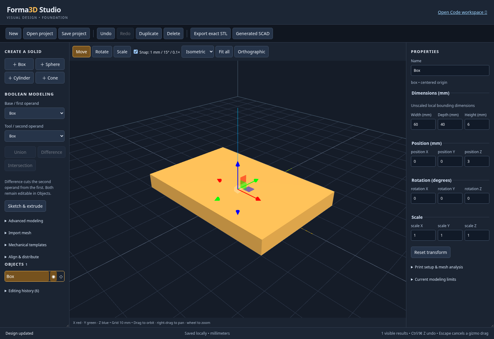
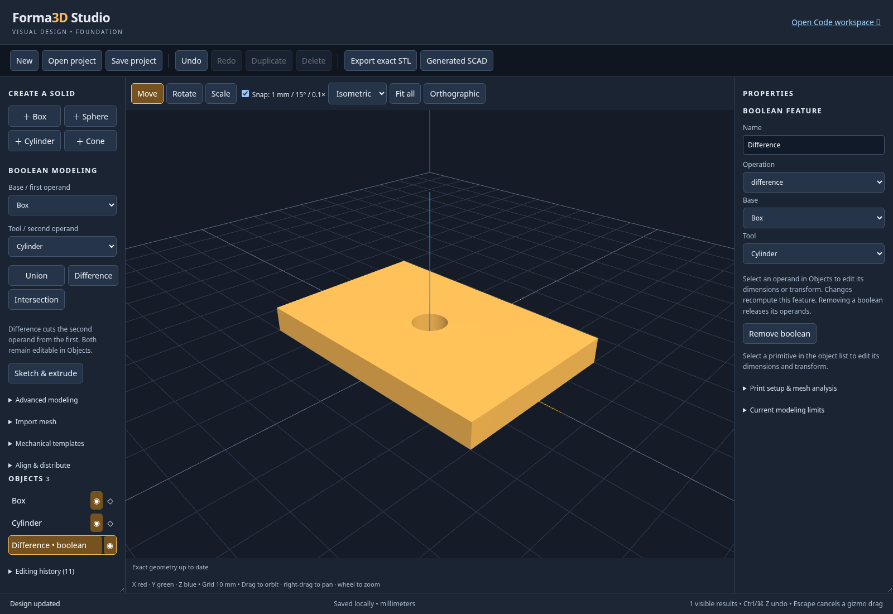
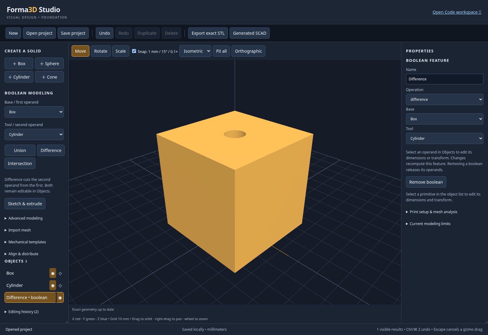
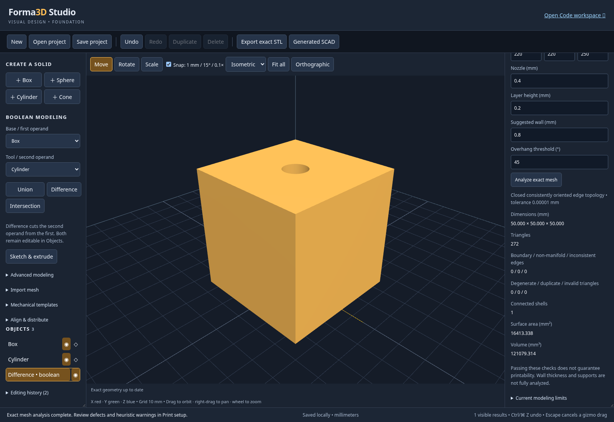
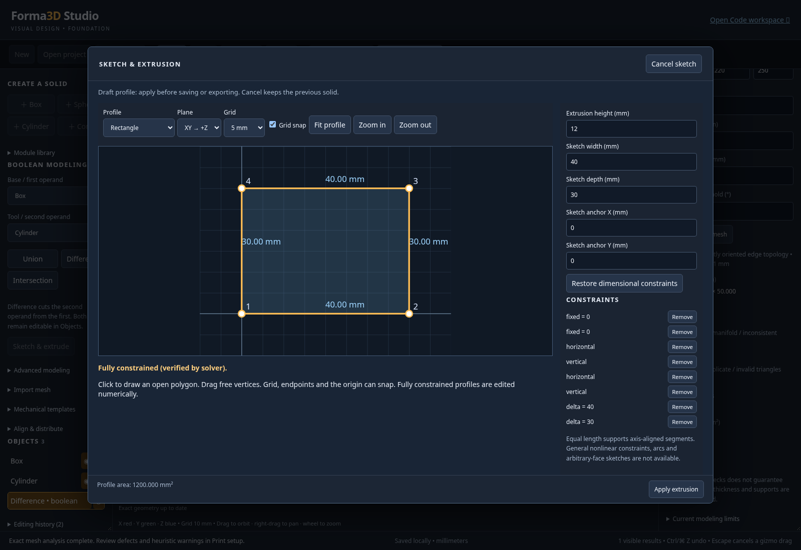
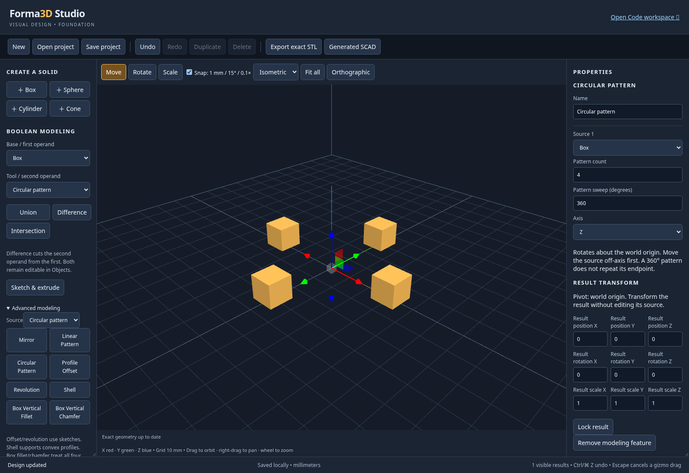
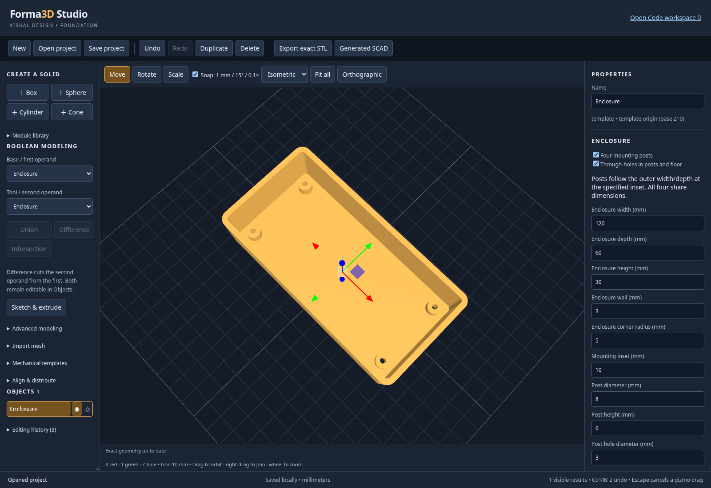
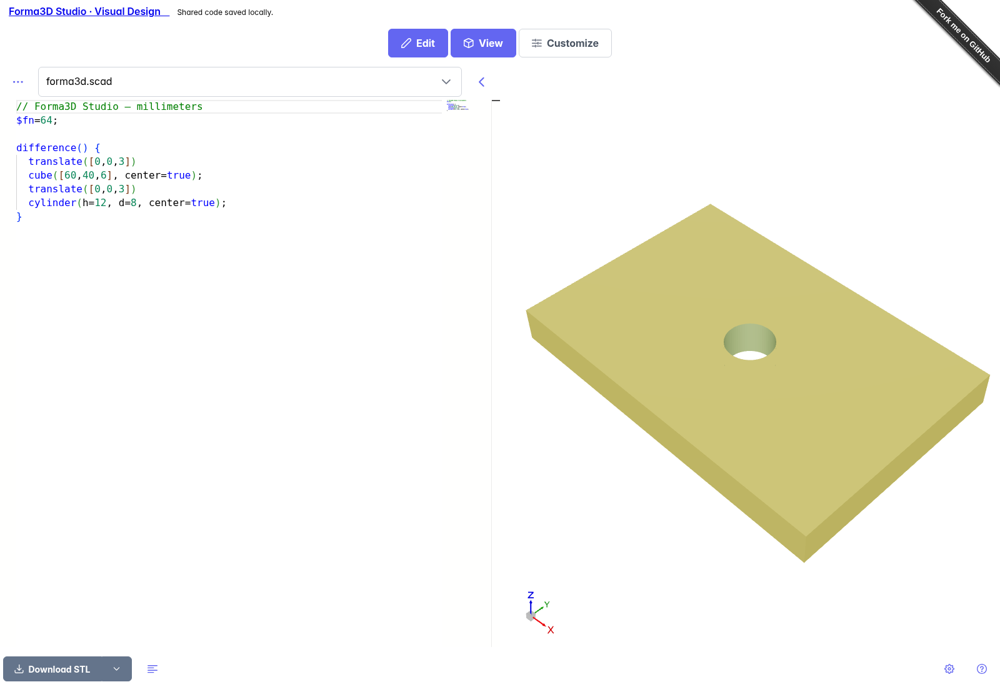

# Forma3D Studio user guide

Use Forma3D Studio to build dimensioned 3D parts in the browser, edit them visually
or in OpenSCAD, and export geometry for a slicer. This guide starts with a complete
first part, then explains the tools you can use on your own designs.

All dimensions in Visual Design are **millimeters**. Screenshots show the real
application and evaluated geometry. Button positions may wrap on smaller screens.

## Contents

- [Open the app](#open-the-app)
- [Find your way around](#find-your-way-around)
- [Make your first part: a plate with a hole](#make-your-first-part-a-plate-with-a-hole)
- [Select, size and move objects](#select-size-and-move-objects)
- [Save, reopen and export](#save-reopen-and-export)
- [Editable boolean modeling](#editable-boolean-modeling)
- [Print setup and inspection](#print-setup-and-inspection)
- [Sketch profiles and extrusion](#sketch-profiles-and-extrusion)
- [Advanced modeling](#advanced-modeling)
- [Align, distribute and place](#align-distribute-and-place)
- [Mechanical templates](#mechanical-templates)
- [Import mesh geometry](#import-mesh-geometry)
- [Switch between visual modeling and Code](#switch-between-visual-modeling-and-code)
- [Keyboard and mouse controls](#keyboard-and-mouse-controls)
- [Troubleshooting](#troubleshooting)
- [Example projects and terminology](#example-projects-and-terminology)

## Open the app

If you already have the app running, open its Visual Design URL, such as
<http://localhost:4000/?studio=1>. From the Code workspace, choose
**Forma3D Studio · Visual Design** to bring its current model into Visual Design.
The app processes geometry in browser workers; no desktop OpenSCAD installation
is needed for these workflows.

For installation and startup, follow the [clone-to-running guide](RUN_FORMA3D.md).
Once set up, run `npm start` from the repository and keep that terminal running.
Use a current desktop browser for the mouse-and-keyboard instructions below.
The Code editor's initial load may need access to its existing CDN.

## Find your way around


| Area | What you do there |
| --- | --- |
| Top toolbar | Start or open a project, save, undo/redo, duplicate/delete, export STL, or inspect generated SCAD. |
| Left panel | Add primitive solids, pick boolean operands, open modeling tools, and select objects in **Objects**. Scroll to reach lower tools. |
| Center viewport | View the part, select surfaces, orbit/pan/zoom, or drag a transform handle. |
| Viewport toolbar | Choose **Move**, **Rotate** or **Scale**, snapping, camera presets, **Fit all**, and **Orthographic**. |
| Right properties panel | Edit the selected object's dimensions, position, rotation, scale or feature settings. Scroll for print settings. |
| Bottom status bar | Read operation errors, local-save status, and the number of visible results. |
| **Open Code workspace** | Edit the current design as SCAD, then return through the matching Visual Design link. |

X is red, Y is green, and Z is blue. Z points upward; the build plate is at Z=0.
The grid spacing is 10 mm. **Fit all** is useful whenever a part appears too large,
too small, or outside the camera view.

## Make your first part: a plate with a hole

You will make a **60 × 40 × 6 mm plate with a centered 8 mm through-hole**, save an
editable project, and export an STL. You can also download the finished
[first-part.forma3d](examples/forma3d/first-part.forma3d) and open it in the app.

### 1. Make the plate

1. Save any work you want to keep, then choose **New**.
2. Click **＋ box** in the left palette. The new **Box** becomes selected.
3. In **Dimensions (mm)** on the right, enter the values below. Press **Enter**
   after each number, or leave the field to commit it.
4. In **Position (mm)**, set **position Z** to **3**. Leave X and Y at zero.
5. Choose **Fit all** above the viewport.

| Box setting | Value |
| --- | --- |
| Width | 60 mm |
| Depth | 40 mm |
| Height | 6 mm |
| Position X / Y / Z | 0 / 0 / 3 mm |

The box's origin is at its center. Half the 6 mm height is 3 mm, so setting Z to
3 places its bottom at Z=0. Changing height alone does not reposition the box.



### 2. Add a cutter and subtract it

1. Click **＋ cylinder**. The cylinder becomes selected.
2. Set **Diameter (mm)** to **8** and **Height (mm)** to **12**.
3. Set **position Z** to **3**; leave X and Y at zero.
4. In the left **Boolean modeling** controls, choose **Box** for
   **Base / first operand**, and **Cylinder** for **Tool / second operand**.
5. Click **Difference**. Wait for **Exact geometry up to date** in the viewport.

The cutter extends below and above the plate so the subtraction passes all the
way through it. Difference removes the second operand from the first. Reversing
those choices would produce a different part.



### 3. Change the hole without starting again

In **Objects**, select **Cylinder**, change **Diameter (mm)** to **10**, and wait
for the result to update. Choose **Undo** to return to the 8 mm hole. The cylinder
remains an editable operand even though it is no longer a separate visible solid.
Select **Difference** to inspect the finished result again.

### 4. Save and export

1. Choose **Save project** and keep the downloaded `.forma3d` file. You can rename
   the downloaded file to `my-first-plate.forma3d` in your file manager.
2. Choose **Export exact STL** and wait for the download to finish.
3. Open the STL in your slicer, use millimeters, and confirm the part is
   **60 × 40 × 6 mm** before slicing.

The native project keeps both operands and the Difference feature. The STL is
triangle geometry for downstream tools; it does not retain those editing controls.

## Select, size and move objects

Click a surface in the viewport or a name in **Objects** to select it. Use the
object list to reach a cutter or source hidden inside a dependent feature.
The properties panel follows the selection.

- **Dimensions** change the object's local size before scale. Sphere dimensions
  can differ to make an ellipsoid. A cylinder's **Diameter** updates width and
  depth together. Dimension and scale values must be positive.
- **Position** moves the object's origin; it is not necessarily the object's
  minimum corner. Imported meshes may have an origin away from their center.
- **Rotation** is in degrees. **Scale** multiplies local size: a 20 mm width at
  scale X=2 becomes 40 mm in that direction before rotation.
- For direct manipulation, choose **Move**, **Rotate** or **Scale** and drag an
  axis handle. Releasing commits one undo step; **Escape** cancels the drag.
- **Duplicate** creates another selected object. **Delete** removes the selection
  when it is not locked or required by another feature. Remove dependents first.
- Lock an object to protect it from edits. Visibility controls whether a standalone
  body or result appears in final output and export. Hide a feature's result to
  omit it; a consumed operand is still evaluated by its dependent feature.

When a modeling feature consumes a source, that source stays in Objects but does
not also export as an extra standalone solid. Select the source to edit it; select
the result to edit the feature's settings. **Undo/Redo** reverses committed edits.

## Save, reopen and export

| Command or file | Use it for | What it keeps |
| --- | --- | --- |
| **Save project** → `.forma3d` | Continue editing later or move to another browser/computer. | Native objects, sketches, feature references, printer settings, mesh assets and retained SCAD sources. |
| **Open project** | Load a downloaded native project or a supported older JSON project. | Validates the file before replacing the current design. |
| Local autosave | Recover the latest visual work in this browser. | One visual recovery slot; watch for **Saved locally**. |
| **Export exact STL** | Send final geometry to a slicer or another mesh tool. | Visible evaluated triangles, in millimeters. |
| **Generated SCAD** → **Download SCAD** | Inspect or use the generated model in desktop OpenSCAD. | Source; mesh-backed models download a ZIP containing source and required mesh files. |
| **Open Code workspace** | Edit SCAD while continuing the same design. | A shared browser-local workspace, saved before switching. |

**Save project** is the portable backup. Local recovery and workspace URLs belong
to the current browser profile and site address. Clearing site data, switching
browsers, using a different port/site, or leaving a private session can make that
local data unavailable. New/Open replaces the visual recovery slot; save a native
file before starting another project. Reloading does not keep the full in-session
undo history.

During an exact export, keep the model unchanged. Use **Cancel export** to stop
an evaluation; if the model changes, retry the rejected export with the current
design. Final visible solids are unioned for export. **Generated SCAD** is a
read-only preview; use the full Code workspace to edit source.

If a recovery read fails, **local autosave stays paused for that session** so the
stored recovery document is preserved. You can keep editing and download with
**Save project**. Download before reloading to retry recovery; New/Open does not
override a failed recovery read.

## Editable boolean modeling

Create two solids, then choose **Base / first operand** and **Tool / second
operand** in the left panel. **Difference** subtracts the second from the first;
**Union** combines them; **Intersection** retains their overlap. Exact geometry
appears after a short worker evaluation. Operands stay in Objects and do not
render as additional standalone solids once consumed.

Select a boolean to edit its operation/references. Select an operand to change
its dimensions or transform; a wireframe helper and gizmo appear. For a circular
cylinder, **Diameter (mm)** changes both width and depth in one undo command.
An empty intersection reports a failure while keeping the project editable.
Correct an operand to recover. Remove dependent features before deleting an
operand; deleting a boolean releases its inputs. Nested booleans may reference
other results. Invalid cycles are rejected.



*Select an operand to change the part without rebuilding the Difference feature.*

## Print setup and inspection

Expand **Print setup & mesh analysis** in the inspector. Set the dimensions for
your own printer: the outlined build volume is centered around X/Y zero and
starts at Z zero. Nozzle/layer/wall/overhang defaults are suggestions.

**Analyze exact mesh** first evaluates the current final model and then measures
it in a worker. Geometry defects, bounds, shell count and volume are separated
from heuristic warnings. Old results disappear when geometry or settings change.
The report does not check all wall thicknesses, self-intersections or support
requirements. STL volume assumes consistent material/cavity shell winding.
The edge weld tolerance is 0.00001 mm, and analysis supports up to 250,000 triangles.
Printer settings are included in autosave and native project files.



*Analyze the final result after you have finished changing the model.*

## Sketch profiles and extrusion

Choose **Sketch & extrude**. The sketch editor opens a separate draft transaction;
**Apply extrusion** commits one undo step and **Cancel sketch** keeps the previous
solid. Unapplied sketches cannot be saved/exported, and navigation warns about the
draft. Applied profiles and constraints participate in project recovery.

- **Rectangle** exposes width, depth and its fixed first-corner anchor. Its
  horizontal/vertical and dimensional constraints are verified by the solver.
- **Circle** exposes radius and center. The default center/radius constraints
  completely determine it. Removed dimensions can be restored explicitly.
- **Polygon / polyline** supports clicking points, grid/endpoint/origin snapping,
  dragging free vertices, or precise **Point X/Y** plus **Add point** entry.
  Close the profile before applying. Open, zero-length, degenerate and
  self-intersecting profiles are reported and cannot be extruded.
- The constraints panel supports fixed coordinates, horizontal/vertical edges,
  coincident points, signed X/Y distances and equal lengths for axis-aligned
  segments. The status reports the solver's remaining degrees of freedom;
  underconstrained polygons are not labeled fully constrained.
- Choose XY (extrude +Z), XZ (extrude −Y), or YZ (extrude +X), and a positive
  extrusion height. Use **Fit profile** or zoom controls when a dimension changes
  beyond the current view. The profile origin is retained, not recentered.

To try a dimensioned sketch, choose **Rectangle**, enter width **40**, depth
**30**, and extrusion height **12** on the XY plane. Choose **Fit profile** to
see it, then **Apply extrusion**. Select the new extrusion and use **Edit sketch**
to change a dimension later.

Select an extrusion in Objects to change its height, **Edit sketch**, or use
normal transform gizmos. Boolean features can reference the extrusion. Editing a
sketch dimension then recomputes dependent geometry; undo restores the prior
profile and exact result.



Profiles are limited to 64 points and 256 constraints. General nonlinear
constraints, arcs, multiple-contour sketches and arbitrary-face attachment are
not available. Coincident endpoints can close a profile even without its explicit
closing edge. Draft point positions are transient until Apply; the last valid
applied document remains intact after invalid edits or worker errors.


## Advanced modeling

Select a solid, expand **Advanced modeling**, and confirm its **Source** before
creating a feature. The original solid stays editable in Objects; the feature
consumes its input for final output. Removing the feature releases that input.
Names, references, settings and independent result transforms persist in projects
and undo/redo. Move/rotate/scale gizmos also work on modeling results. Result
transforms use a world-origin pivot, so rotating a group moves its members around
that origin. Lock a result to protect its parameters and transform.

| Tool | Supported geometry and controls |
| --- | --- |
| Mirror | Reflect any solid about world X/Y/Z planes, with a plane offset and optional original. |
| Linear pattern | 2–100 instances, including the original; X/Y/Z spacing is per instance in world units. |
| Circular pattern | 2–100 instances about a world-origin axis; offset the source first. A full circle avoids a duplicate endpoint; a partial sweep includes both ends. |
| Group | Check independent roots, then **Group selected roots**. The group unions their geometry and adds an independent transform. |
| Box vertical fillet | Round all four vertical edges of a box with a radius smaller than half its width/depth. Outer dimensions stay fixed. |
| Box vertical chamfer | Cut all four vertical edges of a box with the specified straight setback. Outer dimensions stay fixed. |
| Shell | Hollow a box, circular cylinder, rectangular/circular sketch extrusion, or edge-treated box. Set wall thickness and choose an open extrusion end or closed top. |
| Profile offset | Offset a sketch before linear extrusion; choose round, miter or chamfer joins. Negative values inset. Collapsed profiles produce an evaluation error. |
| Revolution | Revolve an XY sketch about its Y axis, mapping sketch X to radius and Y to output Z height. The entire profile must satisfy X ≥ 0; its linear extrusion height is ignored. Set 0 < angle ≤ 360°. |

Fillet/chamfer are four-vertical-edge box operations; arbitrary edge picking is
not available. Shell supports the convex profiles listed above, not arbitrary
boolean or imported solids. Its wall is measured before source scaling; nonuniform
scale changes physical thickness. Apply shell before transforming an edge-treated
feature, then transform the shell result. Graphs are limited to 64 levels and
10,000 expanded primitive instances; very complex evaluations can time out.

To try a circular pattern:

1. Add a box with width, depth and height **10 mm**.
2. Set its position to **X=30, Y=0, Z=5 mm**. This offsets it from the pattern axis.
3. Expand **Advanced modeling**, confirm the box as **Source**, and choose
   **Circular pattern**.
4. Select the pattern result to edit its count, axis, sweep and transform.
5. Select the original box to change the size of every repeated instance.

For a ring, make an XY rectangle with width 5 mm, depth 20 mm and anchor X=10 mm,
apply its extrusion, then choose **Revolution**. The result has inner radius 10 mm,
outer radius 15 mm and height 20 mm. Edit the original sketch to change the ring.



## Align, distribute and place

Expand **Align & distribute**. Choose a target, reference and axis, then align
minimum bounds, centers or maximum bounds. **Center on origin** centers all three
bounds axes; **Place on build plate** moves the minimum Z to zero. These commands
measure actual world-space OpenSCAD STL geometry, including rotations, rather than
using object origins. A reference depending on the target is rejected.

For distribution, check at least three independent roots. Equal gaps uses actual
widths and rejects a layout without enough space; equal centers may overlap.
The outer objects stay fixed. Each action is one undo step. Boolean results get
a reversible transform group; source operands remain intact. Measuring can be
canceled and rejects results if the design changes before completion.

## Mechanical templates

Expand **Mechanical templates**, choose a template and **Add mechanical template**.
Edit its dimensional controls in the inspector; bounds are derived from those
parameters. Templates start at Z=0 and support normal transforms and booleans.

- **Enclosure:** open-top box, wall/floor thickness, rounded vertical corners,
  optional four mounting posts and optional through-holes in posts and floor.
  Mounting inset is measured from the outer edges; posts and holes follow width
  and depth edits. Invalid wall/post fits are rejected, including clearance against rounded cavity corners.
- **Spacer / Standoff:** outer/bore diameters and height; standoff adds a flange.
  A zero bore creates a solid post.
- **Hole cutter:** clearance, counterbore or countersink solid. Nominal diameter
  plus allowance gives the shaft diameter. Head diameter and recess depth or
  countersink angle set the opening. Countersinks use their calculated conical
  depth; the counterbore-depth field does not limit them. Position it through your part and subtract
  it with **Difference**; adding the cutter alone does not create a hole.
- **Mounting tab:** rounded rectangular tab with a dimensioned offset hole.
- **Alignment pin:** shaft with a tapered tip, with configurable dimensions.
- **Snap-fit reference:** cantilever beam with a triangular latch ramp. This is
  reference geometry; it does not calculate strain, material strength or fit.

Printer tolerances, material behavior and snap-fit strength require physical
validation. The supplied enclosure example is 120 × 60 × 30 mm with a 3 mm floor,
four 8 mm posts and 3 mm through-holes. Open
[`parametric-enclosure.forma3d`](examples/forma3d/parametric-enclosure.forma3d) to
change its parameters; the adjacent STL is actual kernel output.



Imported meshes support transforms, mirrors/patterns/groups and closed-mesh
booleans. Profile operations and box edge treatments require the corresponding
native parametric inputs.


## Import mesh geometry

Expand **Import mesh** and choose a local file. Select the source units, choose
**Center X/Y and place on build plate** or **Preserve source coordinates**, check
**I confirm these import units**, then **Import mesh**. Importing is one undo
step. Cancel import stops the worker and keeps the current document; an import
also rejects its result if the design changes while it is running.

| Format | Supported subset | Unit handling |
| --- | --- | --- |
| Binary/ASCII STL | Triangle geometry; binary `solid` headers are detected by actual binary layout. | Explicit assumption required; STL has no reliable unit metadata. |
| OBJ | Vertices, triangle faces and planar convex polygons, including negative indices. Objects/groups flatten into one mesh. | Explicit assumption required. |
| 3MF | Core model, meshes, components and build transforms in one local model part; package relationships/content types are checked. | Format units from the model, or an explicit override. |
| GLB/glTF | Static glTF 2.0 triangle geometry with embedded buffers, node transforms and instances; glTF Y-up becomes Forma3D Z-up. | Format units are meters, or an explicit override. |

For a small known-good practice file, download
[source-cube.stl](examples/forma3d/source-cube.stl), select **mm**, choose plate
placement, confirm the units, then import. It is a 10 mm cube. Choose **Fit all**
and inspect its source dimensions before adding a cutter or pattern.

If an inch-based STL is imported as millimeters, it will be 25.4 times too small.
Undo the import and repeat with the correct units; do not assume every STL is mm.

glTF imports the declared default scene, or its first scene when no default is
declared. Other scenes remain outside this import.

All stored geometry is normalized to millimeters and float32 triangle coordinates.
Available unit assumptions are mm, cm, m, inches, feet and microns. Source
coordinates remain in the asset; automatic plate placement changes the body's
transform. Imported bodies use their source origin for transforms, which may
lie away from their center. Use **Fit all** after large scale/position edits.

The inspector shows source dimensions, surface area, volume when topology permits,
triangle/shell counts and detected topology defects. These are **source**
measurements before the body's transforms or dependent booleans. Use exact mesh
analysis for final world geometry. Imported geometry does not become a complete
editable CAD sketch/feature history; use numeric transforms and the normal gizmos.

Imported meshes remain visual geometry: the Code link is disabled while any
mesh body remains, even if it is hidden or consumed by a feature. Visual modeling,
native save/open, exact STL export, and the read-only SCAD download remain available.

Closed, consistently oriented edge topology allows boolean, mirror, pattern and
group features. Editing an imported operand's transform recomputes its dependents.
Open/defective meshes remain displayable, transformable and savable with diagnostics,
but are blocked from solid evaluation and solid features. No automatic repair,
self-intersection certification or manifold-vertex guarantee is provided.

Materials, textures, animation, skins, morph targets, compressed/required glTF
extensions, external glTF buffers and external/required-extension 3MF components
are unsupported. No referenced external resource is fetched. Triangulate concave,
self-intersecting or nonplanar OBJ polygons in your source tool before importing.
A rejected file leaves the current document intact.

Imports are limited to 10 MB and 100,000 resulting triangles, including instances,
with coordinates within ±1,000,000 mm. Worker import has a 30-second limit. A 3MF
archive has at most 128 entries; each parsed XML part is stream-limited to 4 MB.
Embedded glTF buffers are limited to 20 MB. Projects allow up to 32 distinct mesh
assets totaling 20 MB of normalized binary STL. JSON metadata remains limited to
2 MB; mesh-backed native archives are capped at 25 MB. Large files/assemblies may
need simplification before importing.

Mesh-backed projects use native container version 2 and document schema 6, with
separate SHA-256-checked mesh files. Older valid projects migrate automatically.
Undo/redo, duplication, locking, visibility and recovery preserve asset references.
Unused mesh assets are removed when validating the document after body deletion.
For a mesh-backed model, **Download SCAD** downloads `design.scad.zip`, containing
the generated source and relative `meshes/` assets. Extract them together; the
single SCAD text alone does not contain the mesh geometry.

Open [`imported-mesh.forma3d`](examples/forma3d/imported-mesh.forma3d) for an imported
10 mm cube with a 4 mm through-hole. Change the cylinder diameter or mesh transform;
the preserved source asset and boolean remain independently editable.


## Switch between visual modeling and Code

Use **Open Code workspace** to edit the current visual model as SCAD. Then use
**Forma3D Studio · Visual Design** to bring the current code back. Switching
saves the shared project before navigation; wait for the operation to finish.
Both links use the same browser-local workspace for native shapes. **If any mesh
body exists, Open Code workspace is disabled**, including hidden meshes and mesh
operands inside a boolean or pattern. Remove all mesh bodies to enable it again.
Importing triangles does not create editable OpenSCAD construction steps.
Reloading either view keeps its latest saved work. The switch appears as one
visual undo step, so **Undo** can restore the preceding visual design.

To continue the first-part tutorial in Code:

1. Save a native backup, then choose **Open Code workspace**.
2. Find `cube([60,40,6], center=true);` in the generated scene. Change **60** to
   **70**, leaving its surrounding operation and transforms intact.
3. Wait for the Code preview to update and for the shared-code save status.
4. Choose **Forma3D Studio · Visual Design**. Select **Box** in Objects: its width
   is now **70 mm**, with the centered cutter still referenced by Difference.
5. Choose **Undo** in Visual Design if you want the preceding 60 mm plate back.



*The generated scene contains both editable operands and the subtraction. The
other files, when present, can be selected from the file picker above the editor.*

Unchanged generated code retains the complete native graph, including sketches,
templates and advanced features. Changes to generated primitive dimensions and
transforms retain editable objects and their IDs. Simple standalone primitive
and boolean code can also become native visual objects. Native SCAD is generated
again after visual edits, so formatting and parameter expressions may change.

Generated source uses direct OpenSCAD primitives and operations, without generated
object modules or `n0()` aliases. For example, the first part is expressed as:

```scad
$fn=64;
difference() {
  translate([0,0,3])
  cube([60,40,6], center=true);
  translate([0,0,3])
  cylinder(h=12, d=8, center=true);
}
```

Cylinders use their actual diameter and height; spheres use their actual diameter.
An elliptical shape adds an explicit scale. Patterns expose `for`, `translate`
and `rotate`; sketches expose their profile and extrusion operations.

Code outside the supported native-editing subset stays in Code with an
explanation. It is **not** converted into an opaque mesh object to force a visual
handoff. Your source remains intact. Unchanged generated code can return to its
existing native graph; unsupported structural edits must remain in Code.
Generated editable source is limited to 1 MB. The original standalone Code editor
still supports its broader OpenSCAD workflows.

If two tabs modify the same shared project, the stale tab reports a conflict
rather than overwriting newer work. Download its source before reopening.

Shared workspace URLs identify local IndexedDB records: they are not public
sharing links. Keep `.forma3d` downloads as portable backups. Opening the plain
Code URL starts the original standalone source workflow.


## Keyboard and mouse controls

These controls apply to Visual Design. Text fields and the Code editor also have
their own editing shortcuts; leave a text field to use document undo.

| Action | Control |
| --- | --- |
| Orbit | Drag an empty area of the viewport. |
| Pan | Right-drag in the viewport. |
| Zoom | Mouse wheel. |
| Move / rotate / scale | Choose the mode, then drag an axis handle on the selected object. |
| Commit a number | Enter, or leave the field. |
| Cancel an uncommitted number or gizmo drag | Escape. |
| Undo a committed design edit | Ctrl+Z on Windows/Linux; Command+Z on macOS. |
| Redo | Ctrl/Command+Shift+Z, or Ctrl/Command+Y. |
| Recover a lost camera view | **Fit all**, or choose a camera preset. |
| Toggle parallel projection | **Orthographic**. |

With snapping enabled, gizmo steps are **1 mm** translation, **15°** rotation and
**0.1** scale. Numeric fields can enter more precise values. Rotation and scale
of modeling results use the world-origin pivot; a pattern can therefore move
around the origin when you rotate its result.

## Troubleshooting

| What you see | What to try |
| --- | --- |
| A part is missing, tiny or fills the screen | Choose **Fit all**. Check its visibility, coordinates, scale and import units. A consumed source is edited through Objects rather than shown as another final solid. |
| A numeric edit does not change the model | Press Enter or leave the field. Check for an invalid value or a locked selection. |
| Difference removes the wrong thing | Verify **Base** is the material to keep and **Tool** is the cutter. Ensure they overlap and the cutter passes fully through the part. |
| A boolean or pattern shows an evaluation error | Check overlap, references, dimensions and mesh diagnostics. The document remains editable; fix the source and let it recompute. |
| An intersection produces nothing | Its operands may not overlap. Move or resize them, or undo the feature. |
| Shell, fillet or chamfer is unavailable/rejected | Use one of the supported native inputs in the tool table. These tools do not operate on arbitrary imported meshes or picked edges. |
| A sketch cannot be applied | Close the profile and fix invalid or conflicting constraints. Use **Fit profile** when points lie outside the sketch view. |
| An imported mesh displays but cannot be used as a solid | Read its topology diagnostics. Repair the source in another mesh tool and reimport; displayable open surfaces are not accepted as closed solids. |
| An import is rejected | Check format support, embedded resources, units and the size/triangle limits above. Unsupported input leaves the current design intact. |
| Autosave is paused or fails | Download **Save project** immediately. Check browser storage; keep the downloaded backup before reloading. |
| Code is unavailable after import | Remove every mesh body, including hidden/consumed operands, to restore Code access. Native shapes appear as direct OpenSCAD expressions. |
| A Code switch fails | Read the message and correct the current source or unsupported input. Your code remains available; the visual document is not replaced by a failed conversion. |
| Another-tab conflict is reported | Download the current tab's source/project before reopening the workspace containing the newer work. |
| A workspace URL does not work in another browser | It refers to local data. Transfer a `.forma3d` file and use **Open project** instead. |
| A downloaded mesh-backed SCAD cannot find its meshes | Extract the entire SCAD ZIP and keep its relative `meshes/` folder alongside the source. |

For startup, browser, dependency and hosting problems, see
[run-guide troubleshooting](RUN_FORMA3D.md#10-troubleshooting).

## Example projects and terminology

Download the native file, then choose **Open project**. On GitHub, use the file's
**Download raw file** control if clicking the link opens its repository page.

| Example | Practice |
| --- | --- |
| [First part](examples/forma3d/first-part.forma3d) | Follow this guide's 60 × 40 × 6 mm plate and 8 mm hole. |
| [Editable boolean hole](examples/forma3d/editable-hole.forma3d) | Change the cylinder diameter inside a 50 mm cube. |
| [Sketch plate](examples/forma3d/sketch-plate.forma3d) | Edit the constrained sketch and watch its dependent hole recompute. |
| [Parametric enclosure](examples/forma3d/parametric-enclosure.forma3d) | Adjust walls, floor, posts and mounting-hole parameters. |
| [Imported mesh](examples/forma3d/imported-mesh.forma3d) | Transform a mesh operand while preserving an editable cylindrical cutter. |

A **body** is a primitive, extrusion, template or mesh. A **feature** produces a
result from one or more inputs. An **operand** is an input to a boolean. A
**root** is a result not consumed by another feature; visible roots make up the
final exported model. Older projects may contain a **source-backed model**: an evaluated SCAD mesh
with archived source. Those files remain readable, but their mesh bodies block
Code access just like imported meshes. An **exact result** comes from the
OpenSCAD worker rather than a temporary interactive preview.
