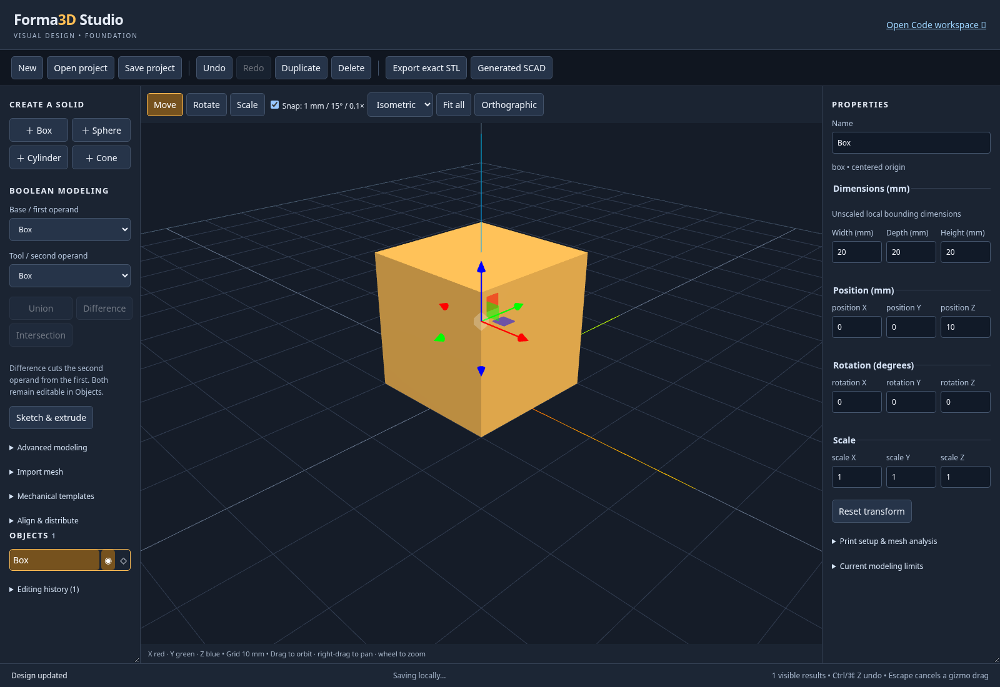
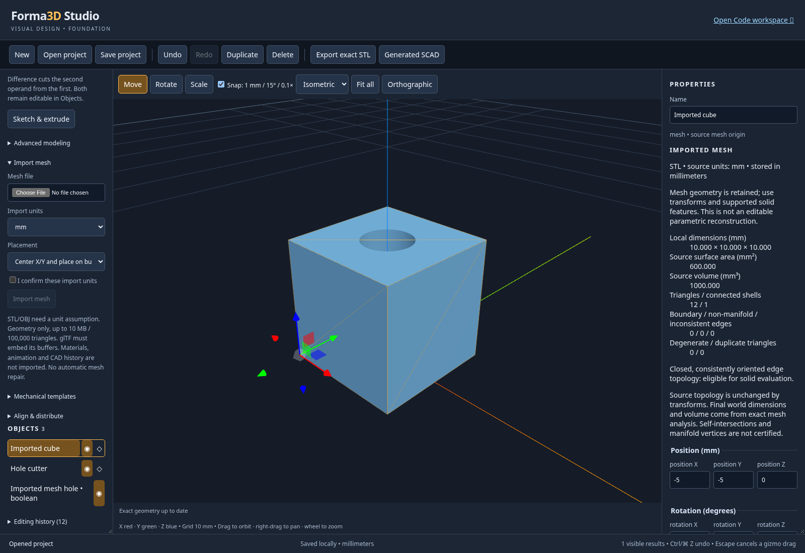
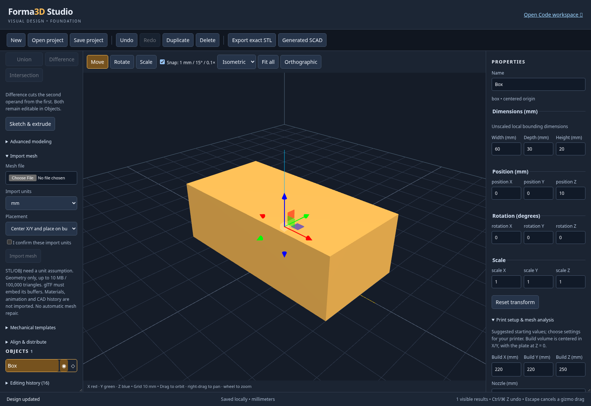
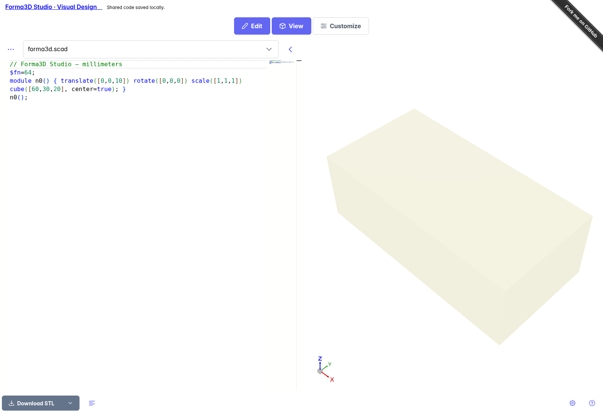

# Forma3D Studio foundation guide

Start the development server with `npm start` after the setup in README.md.
Open `?studio=1` for Visual Design, or use **Forma3D Studio · Visual Design**
in the regular editor to bring its current code into the visual workspace.
The workspace links now carry the current design in both directions.

1. Choose **box**, **sphere**, **cylinder** or **cone** from the left palette.
2. Select a body in the list or click its surface in the workspace.
3. Enter dimensions in the inspector. Width/depth/height are the unscaled local
   bounds, in millimeters. Sphere dimensions can differ to create an ellipsoid.
   Commit numeric values with Enter or by leaving the field. Escape cancels a
   numeric edit. Dimensions and scales must be positive.
4. Use Move, Rotate or Scale and drag an axis handle. Numeric transform fields
   follow the drag. Escape cancels it; releasing normally creates one undo step.
5. Use **Undo/Redo** (Ctrl/Command Z, Shift Z or Y), Duplicate and Delete. A
   locked body cannot be transformed or deleted until unlocked. The visibility
   button hides a body from both workspace and export.
6. Orbit by dragging the workspace; right-drag to pan, wheel to zoom. Choose a
   camera preset, Fit all, or Orthographic. The grid spacing is 10 mm. Snapping
   uses 1 mm translation, 15 degree rotation and 0.1 scale increments.
7. **Save project** downloads a versioned `.forma3d` ZIP file with an integrity
   manifest. **Open project** validates and loads native files or older JSON files. One local recovery slot is autosaved in
   IndexedDB. Keep downloads for durable independent backups. New/Open replace
   the current recovery slot; New can be undone during the current session.
8. **Export exact STL** compiles the visible solids in an OpenSCAD worker. It
   exports the final geometry, never the interactive preview. If you change the
   document during evaluation, retry the rejected export. Use Cancel export to
   stop it. Watch the status bar for errors and local-save failures.
9. **Generated SCAD** opens read-only source with a download button. Use the
   **Open Code workspace** link for editable SCAD and the existing customizer,
   library support and additional export formats.

Exported STL is in millimeters; many STL readers assume a unit because STL itself
has no reliable unit metadata. Final geometry from multiple visible bodies is
unioned by OpenSCAD. Mesh import and mechanical templates are described below.
Mesh inspection does not guarantee printability.

If recovery cannot be read or its saved schema is invalid, **local autosave stays
paused for that session**. The stored recovery document is preserved. You can
continue editing and use **Save project** to download your current work; download
it before reloading to retry recovery. Autosave resumes on a subsequent startup
only when the recovery read succeeds. Watch the persistent local-save status,
including after New/Open; those commands do not override a failed recovery read.

## Editable boolean modeling

Create two solids, then choose **Base / first operand** and **Tool / second
operand** in the left panel. **Difference** subtracts the second from the first;
**Union** combines them; **Intersection** retains their overlap. Exact geometry
appears after a short worker evaluation. Operands stay in Objects and do not
render as additional standalone solids once consumed.

Select a boolean to edit its operation/references. Select an operand to change
its dimensions or transform; a wireframe helper and gizmo appear. For a circular
cylinder, **Diameter (mm)** changes both width and depth in one undo command.
An empty intersection reports a failure while keeping the project editable.
Correct an operand to recover. Remove dependent features before deleting an
operand; deleting a boolean releases its inputs. Nested booleans may reference
other results. Invalid cycles are rejected.

## Print setup and inspection

Expand **Print setup & mesh analysis** in the inspector. Set the dimensions for
your own printer: the outlined build volume is centered around X/Y zero and
starts at Z zero. Nozzle/layer/wall/overhang defaults are suggestions.

**Analyze exact mesh** first evaluates the current final model and then measures
it in a worker. Geometry defects, bounds, shell count and volume are separated
from heuristic warnings. Old results disappear when geometry or settings change.
The report does not check all wall thicknesses, self-intersections or support
requirements. STL volume assumes consistent material/cavity shell winding.
The edge weld tolerance is 0.00001 mm, and analysis supports up to 250,000 triangles.
Printer settings are included in autosave and native project files.

## Screenshots

The hierarchy and inspector stay synchronized with the selected solid.

The cube and cylinder remain editable operands of the Difference feature.

The report comes from actual evaluated triangles; heuristic warnings are labeled.

## Sketch profiles and extrusion

Choose **Sketch & extrude**. The sketch editor opens a separate draft transaction;
**Apply extrusion** commits one undo step and **Cancel sketch** keeps the previous
solid. Unapplied sketches cannot be saved/exported, and navigation warns about the
draft. Applied profiles and constraints participate in project recovery.

- **Rectangle** exposes width, depth and its fixed first-corner anchor. Its
  horizontal/vertical and dimensional constraints are verified by the solver.
- **Circle** exposes radius and center. The default center/radius constraints
  completely determine it. Removed dimensions can be restored explicitly.
- **Polygon / polyline** supports clicking points, grid/endpoint/origin snapping,
  dragging free vertices, or precise **Point X/Y** plus **Add point** entry.
  Close the profile before applying. Open, zero-length, degenerate and
  self-intersecting profiles are reported and cannot be extruded.
- The constraints panel supports fixed coordinates, horizontal/vertical edges,
  coincident points, signed X/Y distances and equal lengths for axis-aligned
  segments. The status reports the solver's remaining degrees of freedom;
  underconstrained polygons are not labeled fully constrained.
- Choose XY (extrude +Z), XZ (extrude −Y), or YZ (extrude +X), and a positive
  extrusion height. Use **Fit profile** or zoom controls when a dimension changes
  beyond the current view. The profile origin is retained, not recentered.

Select an extrusion in Objects to change its height, **Edit sketch**, or use
normal transform gizmos. Boolean features can reference the extrusion. Editing a
sketch dimension then recomputes dependent geometry; undo restores the prior
profile and exact result.

Profiles are limited to 64 points and 256 constraints. General nonlinear
constraints, arcs, multiple-contour sketches and arbitrary-face attachment are
not available. Coincident endpoints can close a profile even without its explicit
closing edge. Draft point positions are transient until Apply; the last valid
applied document remains intact after invalid edits or worker errors.

## Advanced modeling

Select a solid, expand **Advanced modeling**, and confirm its **Source** before
creating a feature. The original solid stays editable in Objects; the feature
consumes its input for final output. Removing the feature releases that input.
Names, references, settings and independent result transforms persist in projects
and undo/redo. Move/rotate/scale gizmos also work on modeling results. Result
transforms use a world-origin pivot, so rotating a group moves its members around
that origin. Lock a result to protect its parameters and transform.

| Tool | Supported geometry and controls |
| --- | --- |
| Mirror | Reflect any solid about world X/Y/Z planes, with a plane offset and optional original. |
| Linear pattern | 2–100 instances, including the original; X/Y/Z spacing is per instance in world units. |
| Circular pattern | 2–100 instances about a world-origin axis; offset the source first. A full circle avoids a duplicate endpoint; a partial sweep includes both ends. |
| Group | Check independent roots, then **Group selected roots**. The group unions their geometry and adds an independent transform. |
| Box vertical fillet | Round all four vertical edges of a box with a radius smaller than half its width/depth. Outer dimensions stay fixed. |
| Box vertical chamfer | Cut all four vertical edges of a box with the specified straight setback. Outer dimensions stay fixed. |
| Shell | Hollow a box, circular cylinder, rectangular/circular sketch extrusion, or edge-treated box. Set wall thickness and choose an open extrusion end or closed top. |
| Profile offset | Offset a sketch before linear extrusion; choose round, miter or chamfer joins. Negative values inset. Collapsed profiles produce an evaluation error. |
| Revolution | Revolve an XY sketch about its Y axis, mapping sketch X to radius and Y to output Z height. The entire profile must satisfy X ≥ 0; its linear extrusion height is ignored. Set 0 < angle ≤ 360°. |

Fillet/chamfer are four-vertical-edge box operations; arbitrary edge picking is
not available. Shell supports the convex profiles listed above, not arbitrary
boolean or imported solids. Its wall is measured before source scaling; nonuniform
scale changes physical thickness. Apply shell before transforming an edge-treated
feature, then transform the shell result. Graphs are limited to 64 levels and
10,000 expanded primitive instances; very complex evaluations can time out.

For a ring, make an XY rectangle with width 5 mm, depth 20 mm and anchor X=10 mm,
apply its extrusion, then choose **Revolution**. The result has inner radius 10 mm,
outer radius 15 mm and height 20 mm. Edit the original sketch to change the ring.

## Align, distribute and place

Expand **Align & distribute**. Choose a target, reference and axis, then align
minimum bounds, centers or maximum bounds. **Center on origin** centers all three
bounds axes; **Place on build plate** moves the minimum Z to zero. These commands
measure actual world-space OpenSCAD STL geometry, including rotations, rather than
using object origins. A reference depending on the target is rejected.

For distribution, check at least three independent roots. Equal gaps uses actual
widths and rejects a layout without enough space; equal centers may overlap.
The outer objects stay fixed. Each action is one undo step. Boolean results get
a reversible transform group; source operands remain intact. Measuring can be
canceled and rejects results if the design changes before completion.

## Mechanical templates

Expand **Mechanical templates**, choose a template and **Add mechanical template**.
Edit its dimensional controls in the inspector; bounds are derived from those
parameters. Templates start at Z=0 and support normal transforms and booleans.

- **Enclosure:** open-top box, wall/floor thickness, rounded vertical corners,
  optional four mounting posts and optional through-holes in posts and floor.
  Mounting inset is measured from the outer edges; posts and holes follow width
  and depth edits. Invalid wall/post fits are rejected, including clearance against rounded cavity corners.
- **Spacer / Standoff:** outer/bore diameters and height; standoff adds a flange.
  A zero bore creates a solid post.
- **Hole cutter:** clearance, counterbore or countersink solid. Nominal diameter
  plus allowance gives the shaft diameter. Head diameter and recess depth or
  countersink angle set the opening. Countersinks use their calculated conical
  depth; the counterbore-depth field does not limit them. Position it through your part and subtract
  it with **Difference**; adding the cutter alone does not create a hole.
- **Mounting tab:** rounded rectangular tab with a dimensioned offset hole.
- **Alignment pin:** shaft with a tapered tip, with configurable dimensions.
- **Snap-fit reference:** cantilever beam with a triangular latch ramp. This is
  reference geometry; it does not calculate strain, material strength or fit.

Printer tolerances, material behavior and snap-fit strength require physical
validation. The supplied enclosure example is 120 × 60 × 30 mm with a 3 mm floor,
four 8 mm posts and 3 mm through-holes. Open
[`parametric-enclosure.forma3d`](examples/forma3d/parametric-enclosure.forma3d) to
change its parameters; the adjacent STL is actual kernel output.

Imported meshes support transforms, mirrors/patterns/groups and closed-mesh
booleans. Profile operations and box edge treatments require the corresponding
native parametric inputs.

## Import mesh geometry

Expand **Import mesh** and choose a local file. Select the source units, choose
**Center X/Y and place on build plate** or **Preserve source coordinates**, check
**I confirm these import units**, then **Import mesh**. Importing is one undo
step. Cancel import stops the worker and keeps the current document; an import
also rejects its result if the design changes while it is running.

| Format | Supported subset | Unit handling |
| --- | --- | --- |
| Binary/ASCII STL | Triangle geometry; binary `solid` headers are detected by actual binary layout. | Explicit assumption required; STL has no reliable unit metadata. |
| OBJ | Vertices, triangle faces and planar convex polygons, including negative indices. Objects/groups flatten into one mesh. | Explicit assumption required. |
| 3MF | Core model, meshes, components and build transforms in one local model part; package relationships/content types are checked. | Format units from the model, or an explicit override. |
| GLB/glTF | Static glTF 2.0 triangle geometry with embedded buffers, node transforms and instances; glTF Y-up becomes Forma3D Z-up. | Format units are meters, or an explicit override. |

glTF imports the declared default scene, or its first scene when no default is
declared. Other scenes remain outside this import.

All stored geometry is normalized to millimeters and float32 triangle coordinates.
Available unit assumptions are mm, cm, m, inches, feet and microns. Source
coordinates remain in the asset; automatic plate placement changes the body's
transform. Imported bodies use their source origin for transforms, which may
lie away from their center. Use **Fit all** after large scale/position edits.

The inspector shows source dimensions, surface area, volume when topology permits,
triangle/shell counts and detected topology defects. These are **source**
measurements before the body's transforms or dependent booleans. Use exact mesh
analysis for final world geometry. Imported geometry does not become a complete
editable CAD sketch/feature history; use numeric transforms and the normal gizmos.

Closed, consistently oriented edge topology allows boolean, mirror, pattern and
group features. Editing an imported operand's transform recomputes its dependents.
Open/defective meshes remain displayable, transformable and savable with diagnostics,
but are blocked from solid evaluation and solid features. No automatic repair,
self-intersection certification or manifold-vertex guarantee is provided.

Materials, textures, animation, skins, morph targets, compressed/required glTF
extensions, external glTF buffers and external/required-extension 3MF components
are unsupported. No referenced external resource is fetched. Triangulate concave,
self-intersecting or nonplanar OBJ polygons in your source tool before importing.
A rejected file leaves the current document intact.

Imports are limited to 10 MB and 100,000 resulting triangles, including instances,
with coordinates within ±1,000,000 mm. Worker import has a 30-second limit. A 3MF
archive has at most 128 entries; each parsed XML part is stream-limited to 4 MB.
Embedded glTF buffers are limited to 20 MB. Projects allow up to 32 distinct mesh
assets totaling 20 MB of normalized binary STL. JSON metadata remains limited to
2 MB; mesh-backed native archives are capped at 25 MB. Large files/assemblies may
need simplification before importing.

Mesh-backed projects use native container version 2 and document schema 6, with
separate SHA-256-checked mesh files. Older valid projects migrate automatically.
Undo/redo, duplication, locking, visibility and recovery preserve asset references.
Unused mesh assets are removed when validating the document after body deletion.
For a mesh-backed model, **Download SCAD** downloads `design.scad.zip`, containing
the generated source and relative `meshes/` assets. Extract them together; the
single SCAD text alone does not contain the mesh geometry.

Open [`imported-mesh.forma3d`](examples/forma3d/imported-mesh.forma3d) for an imported
10 mm cube with a 4 mm through-hole. Change the cylinder diameter or mesh transform;
the preserved source asset and boolean remain independently editable.

## Switch between visual modeling and Code

Use **Open Code workspace** to edit the current visual model as SCAD. Then use
**Forma3D Studio · Visual Design** to bring the current code back. Switching
saves the shared project before navigation; wait for the operation to finish.
Both links use the same browser-local workspace, including imported mesh assets.
Reloading either view keeps its latest saved work. The switch appears as one
visual undo step, so **Undo** can restore the preceding visual design.

Unchanged generated code retains the complete native graph, including sketches,
templates and advanced features. Changes to generated primitive dimensions and
transforms retain editable objects and their IDs. Simple standalone primitive
and boolean code can also become native visual objects. Native SCAD is generated
again after visual edits, so formatting and parameter expressions may change.

For code outside that supported subset, Studio renders the exact current source
as a **SCAD model** mesh and retains its source files and customizer values. You
can move, rotate, scale and combine that object with visual features. Open Code
again to edit the original program; the generated scene includes it with your
visual transforms. Library `use` declarations move to the generated scene entry
with annotations in the retained files. Edit those files, then select the
generated scene entry before rendering or returning to Visual Design. Saving a
`.forma3d` project preserves the retained source.
Complex source does not acquire an invented primitive or sketch history.

Invalid code, unsupported context-sensitive module introspection, invalid solids
and oversized source bundles stop the switch and leave your code available.
The converter allows 64 source files and 1 MB of text/embedded attachments;
individual non-STL attachments are limited to 256 KB. Mesh limits still apply.
If two tabs modify the same shared project, the stale tab reports a conflict
rather than overwriting newer work. Download its source before reopening.

Shared workspace URLs identify local IndexedDB records: they are not public
sharing links. Keep `.forma3d` downloads as portable backups. Opening the plain
Code URL starts the original standalone source workflow.

